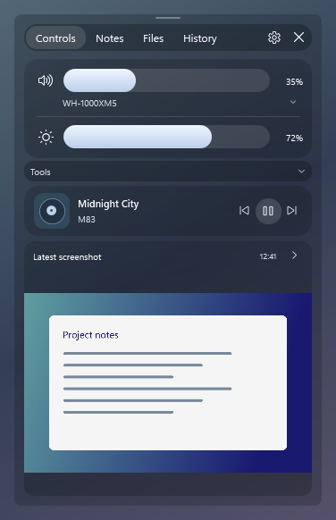
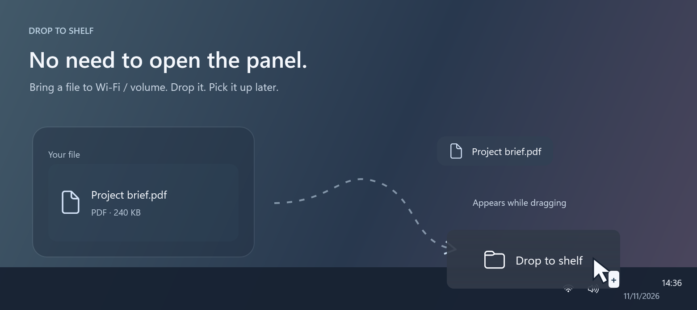
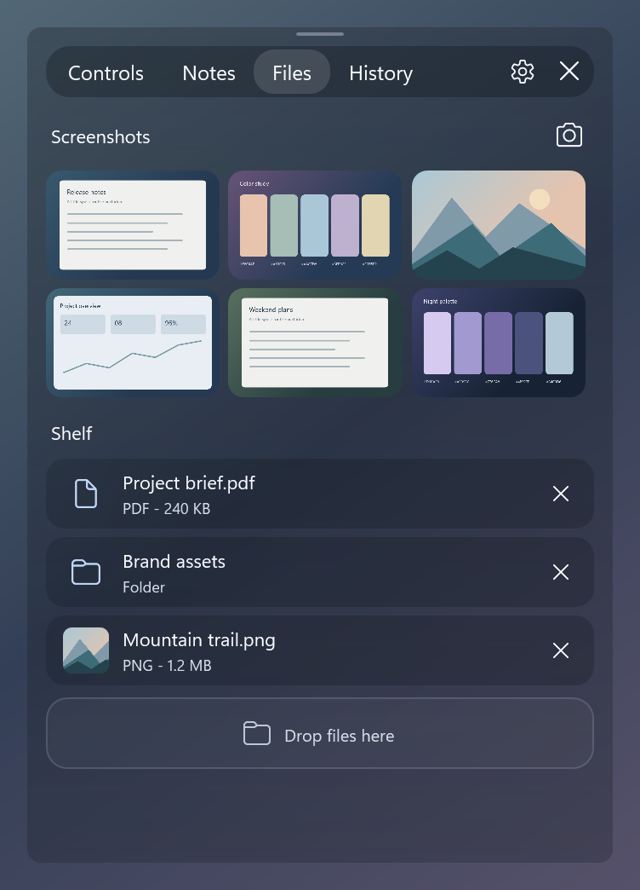
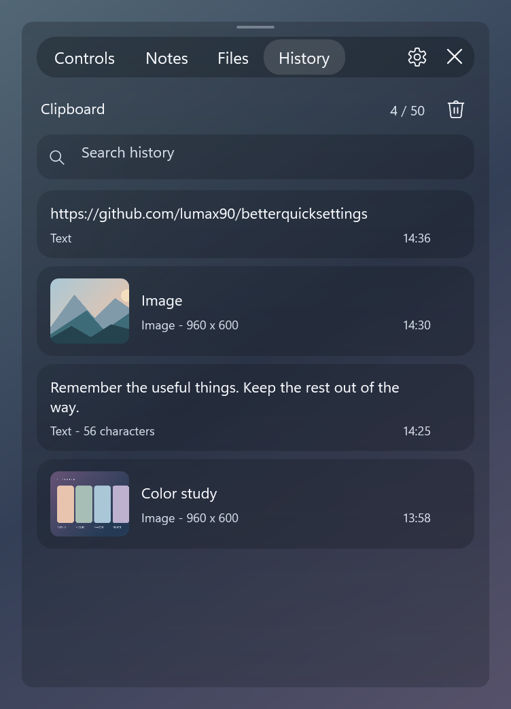
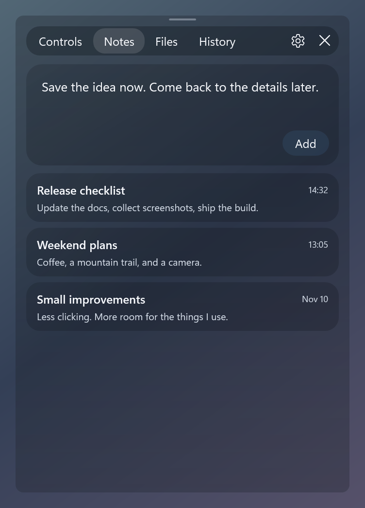
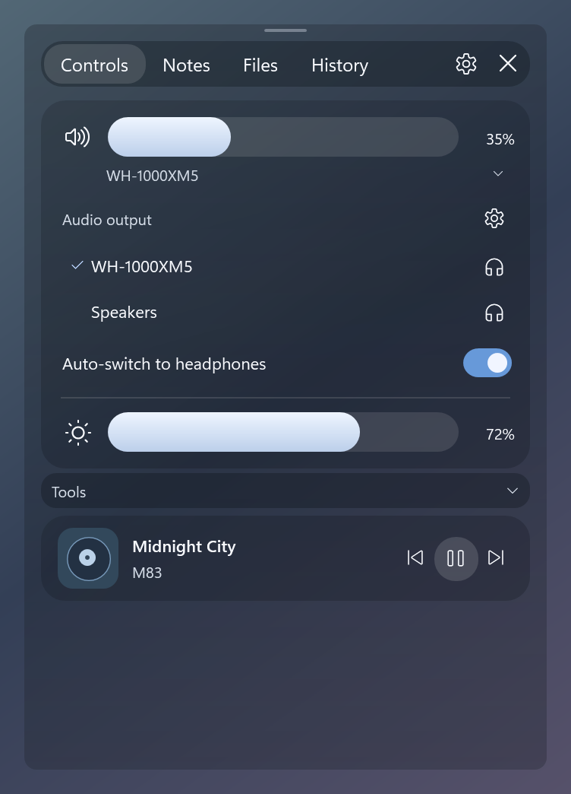

# BetterQuickSettings

A compact, native replacement for Windows 11 Quick Settings. Open it from the
existing network/volume area or with **Win + A**.

Built with **C# · .NET 10 · WPF**. Licensed under **MIT**.

## Download — v0.1.0-beta.1

**Early beta:** bugs and Windows/device compatibility issues are expected.

| Windows 11 x64 | |
| --- | --- |
| **[Download Setup.exe](https://github.com/lumax90/betterquicksettings/releases/download/v0.1.0-beta.1/BetterQuickSettings-0.1.0-beta.1-win-x64-Setup.exe)** | Recommended. Per-user install, Start menu shortcut, and uninstall support. |
| **[Download Portable.zip](https://github.com/lumax90/betterquicksettings/releases/download/v0.1.0-beta.1/BetterQuickSettings-0.1.0-beta.1-win-x64-Portable.zip)** | Extract everything, then run `BetterQuickSettings.exe`. No installation. |

Both include .NET; no separate runtime installation is needed. Close any running
copy before installing or updating. **This beta is unsigned**, so Windows may
display a SmartScreen warning. See the [release notes and checksums](https://github.com/lumax90/betterquicksettings/releases/tag/v0.1.0-beta.1).



*Source-XAML preview with sample data. Live glass uses the Windows compositor.*

## Features

- **Audio:** volume, mute, output selection, automatic headphone switching, and a
  short feedback sound when the volume slider is released.
- **Brightness and media:** DDC/CI or supported built-in display brightness;
  playback controls and artwork from Windows media sessions.
- **Glass panel:** adjustable transparency, collapsible tools, animated tabs,
  and a remembered height that can be changed using the top handle.
- **Notes:** multiple notes with editing, automatic saving, and draft recovery.
- **File shelf:** drop files or folders to keep independent copies, then drag them
  into another application later. A drop balloon appears over the network/volume
  area even when the panel is closed.
- **Screenshots:** recent captures, image previews, and drag-to-share thumbnails.
  The latest 24 captures are retained; **Keep on shelf** preserves a capture.
- **Clipboard history:** searchable text and images, limited to 50 entries and
  32 MB of content, with re-copy and deletion controls.
- **Tools:** a focus timer, casting, and quick links to Windows settings.

## A closer look

### Drop now, use it later

Drag a file over the **network/volume area** and the shelf balloon appears—no
need to open the panel first. Drop it there, then drag the saved copy into another
application whenever you need it.



*Illustrated drag gesture with the real source-XAML drop target; the desktop,
file, and cursor are staged for documentation.*

<table>
  <tr>
    <td width="50%" valign="top">
      <h3>Screenshots &amp; file shelf</h3>
      <p>Recent captures and reusable file copies, ready to drag into another app.</p>
      
    </td>
    <td width="50%" valign="top">
      <h3>Clipboard history</h3>
      <p>Find a link, a snippet, or an image you copied earlier. Click to copy again.</p>
      
    </td>
  </tr>
  <tr>
    <td width="50%" valign="top">
      <h3>A place for quick notes</h3>
      <p>Capture a thought, keep a draft, and come back to your saved notes.</p>
      
    </td>
    <td width="50%" valign="top">
      <h3>Sound, without the detour</h3>
      <p>Choose an output, enable automatic headphone switching, and control playback.</p>
      
    </td>
  </tr>
</table>

*Panel previews use the actual application XAML and synthetic sample content.
Live transparency depends on the Windows compositor and the desktop behind it.*

## Build and run

Requires **Windows 11 x64** and the **[.NET 10 SDK](https://dotnet.microsoft.com/download/dotnet/10.0)**.

```powershell
git clone https://github.com/lumax90/betterquicksettings.git
cd betterquicksettings
dotnet run --project BetterQuickSettings.csproj -c Release
```

Create a portable build, including its .NET runtime:

```powershell
dotnet publish BetterQuickSettings.csproj -c Release -r win-x64 --self-contained true -o artifacts/win-x64
```

Run `artifacts/win-x64/BetterQuickSettings.exe`. Keep the entire published folder
together. `--background` starts the application in the tray.

The PowerShell helper supports `run`, `build`, `check`, `publish`, and `capture`:

```powershell
powershell -NoProfile -ExecutionPolicy Bypass -File .\run.ps1 build
```

## Using the panel

| Action | Shortcut / control |
| --- | --- |
| Open or close | **Win + A**, network/volume area, or tray icon |
| Open the original Windows panel | **Shift + click** the network/volume area |
| Dismiss | **Esc** or click outside |
| Keep it visible | **Preferences → Keep panel open** |
| Change height | Drag the small handle along the top edge |
| Notes / add note | **Ctrl + N** / **Ctrl + Enter** |
| File shelf | **Ctrl + F** |
| Clipboard history | **Ctrl + H**; **Ctrl + F** searches within History |
| Copy a shelf file | Focus it and press **Ctrl + C** |
| Quit | Tray menu → **Exit** |

Files stays three columns wide and scrolls with the mouse wheel or touchpad.
History items are copied back to the clipboard when clicked; paste them normally
with **Ctrl + V**. Startup registration is optional under **Preferences**.

## Local storage

Settings, notes, file copies, and clipboard history are saved on the device under
`%LOCALAPPDATA%\BetterQuickSettings\`. There is no account, server, or telemetry.
`--data-dir <directory>` selects a different storage directory.

Upgrades from the earlier Ada preview reuse its existing `%LOCALAPPDATA%\Ada\`
directory when no BetterQuickSettings directory exists. Existing notes, shelf
copies, and clipboard history remain available.

- Incoming shelf files are **copied**. Removing a shelf item never deletes its
  original source. Outgoing drags are copy-only.
- Clipboard entries honor applications' Windows clipboard-history exclusion
  markers. Collection can be paused in Preferences or cleared from History.
- Clipboard text is limited to 200,000 characters per entry; images are limited
  to 8 MB encoded and 16 megapixels.
- Indexes and notes use atomic file replacement.

## Compatibility

This is an early preview. Hardware and Windows shell variations may affect some
features:

- Wi-Fi, Bluetooth, and night light open their Windows settings pages. Casting
  opens **Win + K**.
- Monitor brightness requires DDC/CI support; the built-in display fallback is
  available when a single logical display is connected.
- Default audio output selection uses an isolated Windows compatibility API.
- The shelf accepts ordinary Windows file drops. Virtual email attachments and
  linked directories are not supported.
- Screenshot collection observes new captures while the application runs; it
  does not import an existing gallery on startup.

## Development

Run storage and routing checks:

```powershell
dotnet run --project checks/BetterQuickSettings.Checks.csproj -c Release
```

Generate non-activating previews directly from the source XAML:

```powershell
powershell -NoProfile -STA -ExecutionPolicy Bypass -File .\design\preview.ps1
```

Previews use sample data and do not access the clipboard or hardware. See
[CONTRIBUTING.md](CONTRIBUTING.md) for project conventions and native diagnostics.

## License

[MIT](LICENSE). Dependency licenses are documented in
[THIRD_PARTY_NOTICES.md](THIRD_PARTY_NOTICES.md) and included in portable builds.
